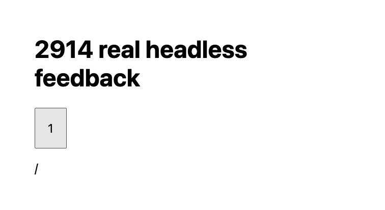
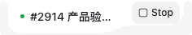
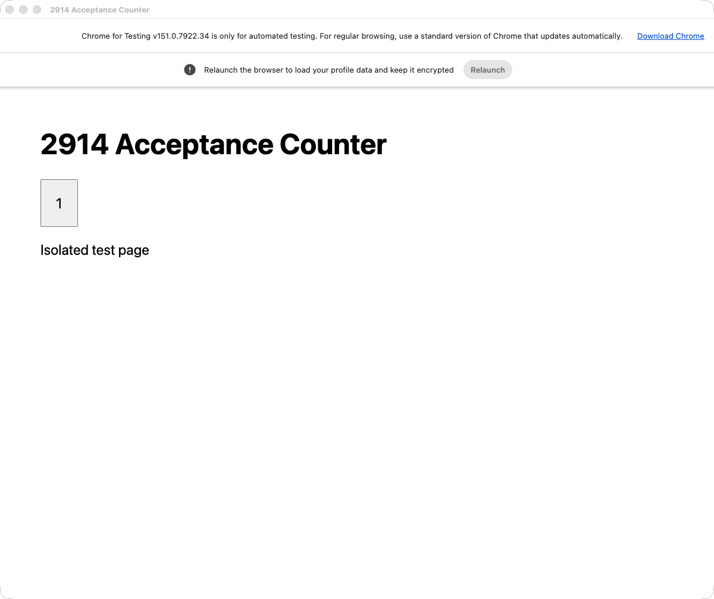

# Control feedback acceptance evidence

Refs GUYI-AI/gugu#2914 and GUYI-AI/gugu-apps#321.

Client: official Beta `0.3.7-beta.44342843803.1`, source `e98f225326ce3554ce8a4477c86b6fe97f23c1cb` (API58). Apps: Browser Use 0.4.1 and Computer Use 0.5.2, installed through the normal App installer and visible consent dialogs in one isolated test profile.

## Actual packaged headless path

The official package's server-task-browser and its already loaded page-lease function drove real Chrome151 over the production pipe transport. An Inspector reference exposed that existing function to the acceptance probe; no package files or host-stamped agent identities were rewritten. The real counter changed from 0 to 1. Five actual JPEG frames were captured. Their feedback included the current target revision, cursor, confirmed click, and running action. Aborting the call removed its action; navigation cleared the old cursor and advanced the revision. A new dispatch produced a new current-target picture. The earlier real picture and the undecorated navigation picture both failed the current-picture check.

These are original raw pixels. Cursor/action feedback is a separate frame payload, recorded in `verification.json`; no cursor or labels have been drawn onto this JPEG. This proves the packaged headless capture/feedback path, not a complete server deployment or the renderer's final projection.

## Actual native Computer Use

One real task used the installed Computer Use tools to locate its isolated Chrome counter window, capture it, click its button, and read back AXButton 1 and the original screenshot. The actual native App surface displayed the same task and Stop. The originals below come from that surface and the real native tool result. The click used background PX-to-AX delivery; foreground OS pointer passthrough remains to be exercised.

A diff read returned a typed-output mismatch. The probe did not repeat the click; a full state read confirmed the result. `native-tool-results.json` retains both the error and the successful readback.

## Capture timing and limits

The first exploratory headless capture attempt timed out after eight seconds. Its root cause is not established. Subsequent immediate, Page-enable-only, and 300ms-delay-only cases each produced seven frames with zero capture errors and first-frame latency of 62ms, 51ms, and 13ms. All clicks returned 1. No product change is claimed to have fixed the earlier timeout.

The real Chrome151 source regression passed all five tests, including both opt-in cases, with zero skips and exit 0. Six relevant test/source files matched the released client source byte-for-byte. This supports the packaged exercise and is not substituted for it.

Physical phone acceptance and the remaining full-product visual checks remain tracked in #2914. SHA256 and byte counts in `verification.json` refer to these unchanged original image files.
