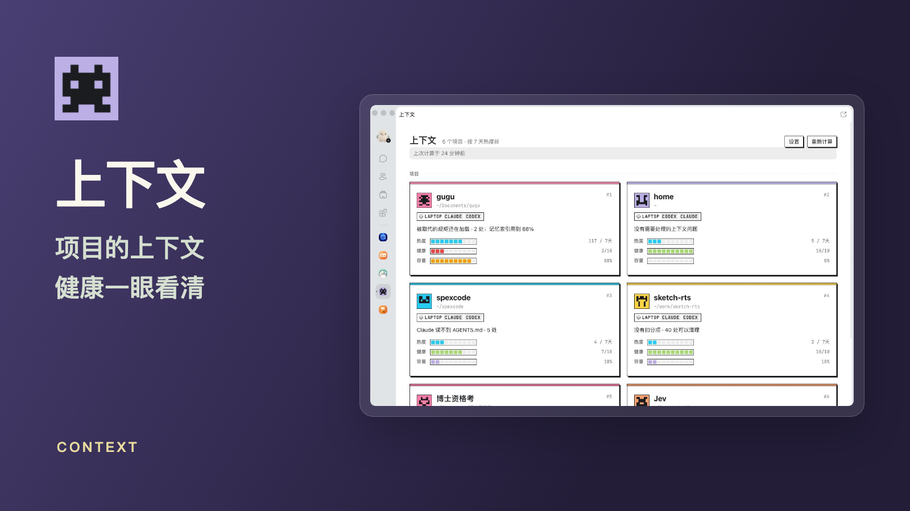
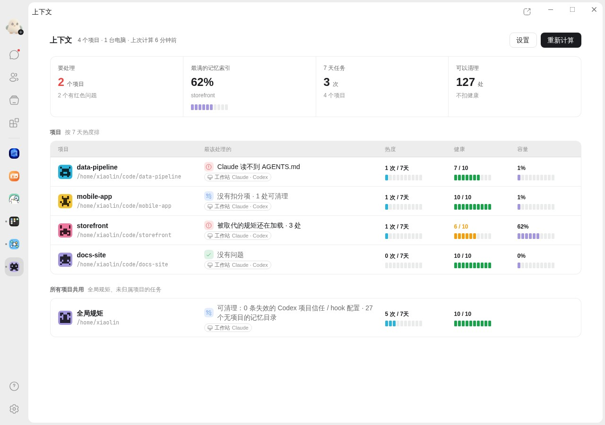
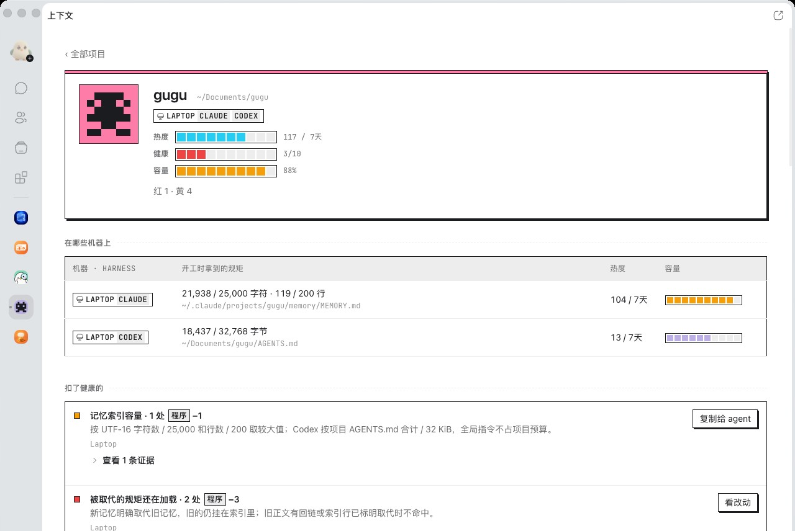
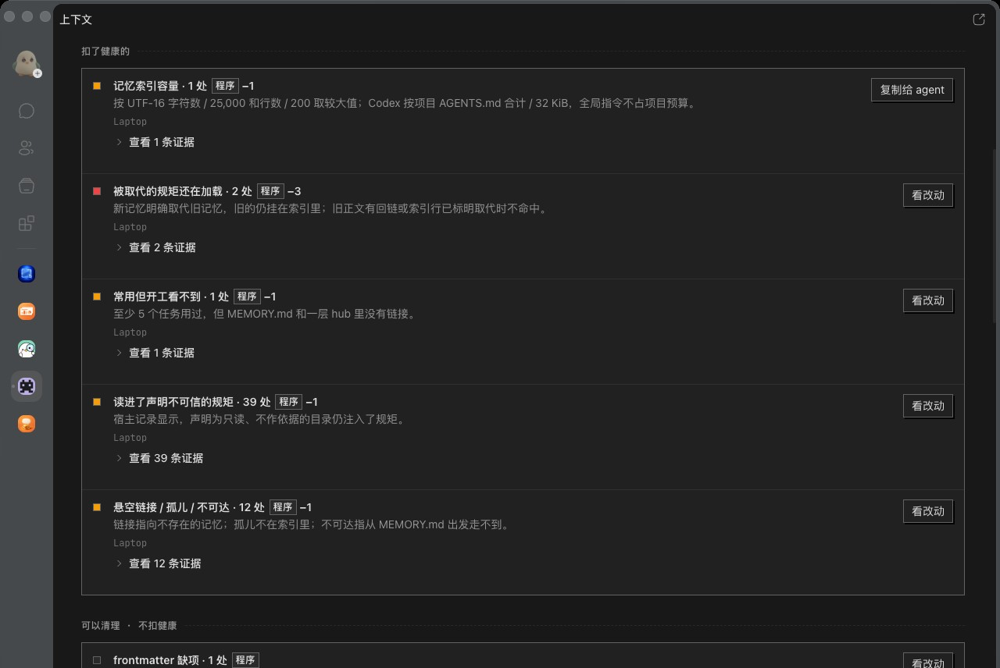

# 上下文 / Context

按项目查看 Claude 和 Codex 的任务热度、上下文健康和加载容量。每个项目一行，带像素头像和十格条；总览显示要处理的项目、最满的记忆、任务数和可清理项，浅色和深色随咕咕主题变化。

- 自动找到这台电脑上 Claude 和 Codex 的配置，同一个仓库在几台电脑上合成一张卡。
- 主图按近 7 天的任务热度列出最多 8 个项目，其余列成文字。
- 诊断直接读文件和咕咕的任务记录，不消耗模型额度；每条写明扣分、口径和证据，可清理的不扣健康。需要判断语义的几项只给出可复制的提示。
- 修复先给你看完整改动，确认后才写，并保存改前的快照；文件在这期间变了就不改。
- 跨电脑的读数要在每台参与的电脑上装同一版本的上下文。读不到的地方会明确写「未测」。

如果有配置或项目没被找到，在 App 的「设置」页补上它的路径，每行一个。

上下文不读凭据和登录文件，不发消息，也不派 agent。
