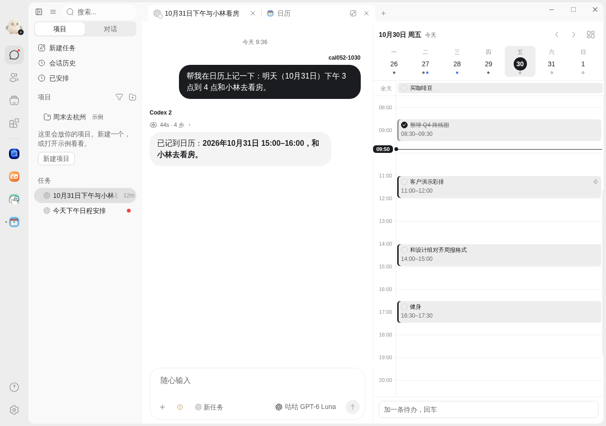
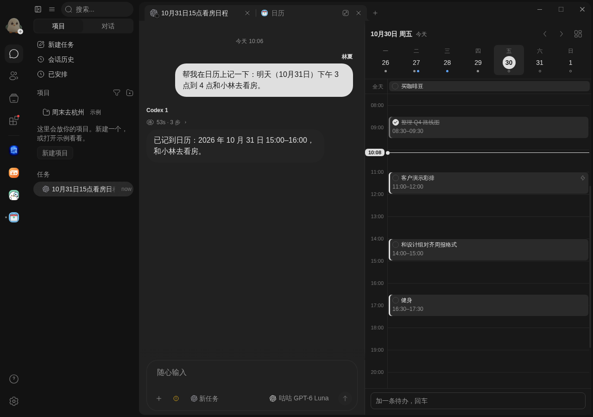
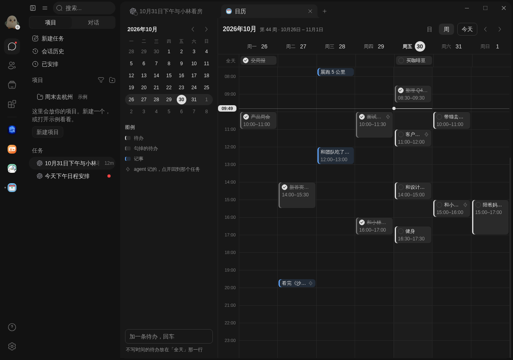

# 日历

按时间轴看的日历。任务页右侧栏里是一天：上面一行这一周，下面是从早到晚的时间轴；整页打开是一周，左边一个小月历。

## 页面上

- 每一条按它的钟点放在时间轴上：待办是灰底墨色边，勾掉的划线，记事是蓝底蓝边；agent 记的带一个 ⚡。同一时间的几条并排。
- 没写时间的待办放在最上面「全天」那一行。
- 一条横线和左边的时间牌是现在。
- 在空白的时间上点一下（或按住往下拖出长短），写一行，选待办或记事，回车加上；底部输入框加的是「全天」待办。
- 点一条看它的卡片：详情、标签、什么时候记的、回到记下它的任务、删掉。待办前面的圈直接勾。
- 侧栏：周条上点哪天看哪天，右上角展开整月。整页：「日 / 周」切换，左右箭头翻一周（或一天），「今天」回来。

## 数据

都存在这台电脑上、这个 App 自己的数据里，卸载就删掉。你在页面上的改动和 agent 记的走同一条路，谁也不会把谁的覆盖掉。agent 记下一条以后，开着的页面几秒内就会显示出来。

在任务里跟 agent 说「记一下」「明天下午提醒我」，它会记到这里。勾掉和删掉只有你在页面上能做。

## 需要的能力

给 agent 提供记日历的工具。
