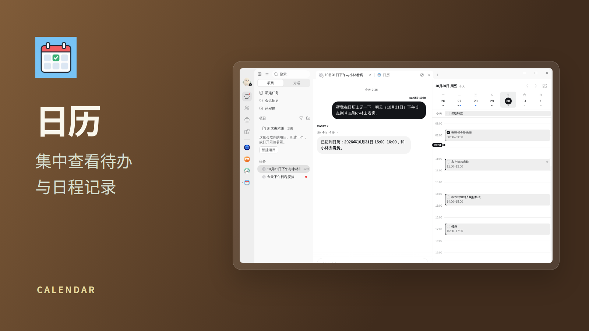
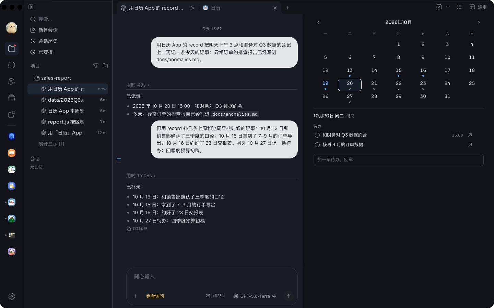
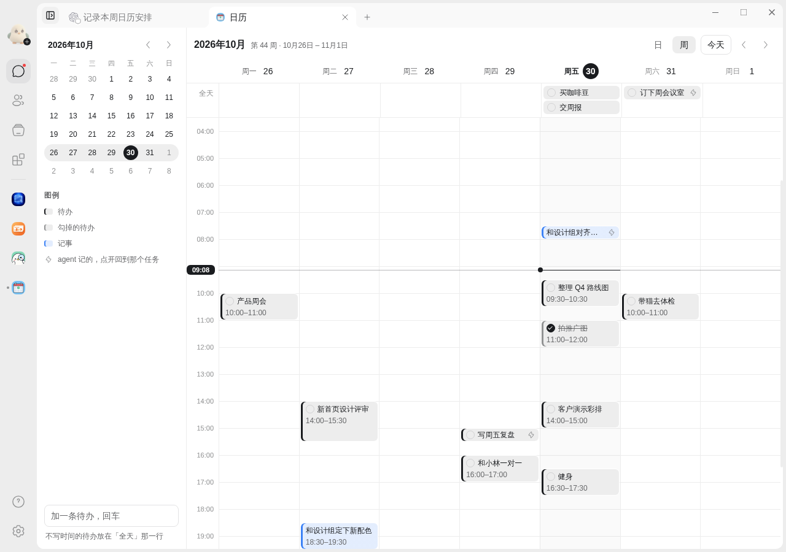

# 日历

按时间轴看的日历。任务页右侧栏里是一天：上面一行这一周，下面是从早到晚的时间轴；整页打开是一周，左边一个小月历。

## 页面上

- 每一条按它的钟点放在时间轴上：待办是灰底墨色边，勾掉的划线，记事是蓝底蓝边；agent 记的带一个 ⚡。同一时间的几条并排。
- 没写时间的待办放在最上面「全天」那一行。
- 一条横线和左边的时间牌是现在。
- 在空白的时间上点一下（或按住往下拖出长短），写一行，选待办或记事，回车加上；底部输入框加的是「全天」待办。
- 点一条看它的卡片：详情、标签、什么时候记的、回到记下它的任务、删掉。待办前面的圈直接勾。
- 侧栏：周条上点哪天看哪天，右上角展开整月。整页：「日 / 周」切换，左右箭头翻一周（或一天），「今天」回来。

## agent 怎么用

`record({ kind, title, detail?, tags?, date?, time?, end? })`：

- `kind`：`todo` 是打算做的事（能勾），`memory` 是已经发生的事；
- `title`：一行，用人的原话；
- `date`：`YYYY-MM-DD`，要是真有的一天，不写就是今天；`time`：`HH:MM`，记事不写就是现在；
- `end`：`HH:MM`，比 `time` 晚，有长短的事（14:00 到 15:00 的会）才写；不写的按半小时画；
- 同一天、同一类、同一行字只记一次，重试不会多出一条。

勾掉和删掉只在页面上能做，agent 看不到这两个工具。

## 数据

都存在这个 App 自己的数据文件夹里（`journal.json`），只有它自己的程序写：页面上的改动和 agent 的 `record` 走的是同一个程序，谁也不会把谁的覆盖掉。卸载就删掉。agent 记下一条以后，开着的页面在 3 秒内显示出来；页面不在屏幕上时不去读；正在写新的一条时，等写完再刷新。

## 较早的咕咕

「回到记下它的任务」要咕咕能告诉程序是哪个任务调的它，并且有 `showSession`。没有的咕咕上，记事照常记，只是卡片上没有这个按钮。

## 需要的能力

给 agent 提供工具（`agents:tools`）。
