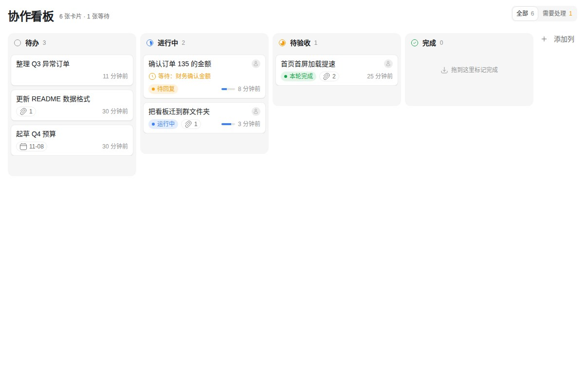
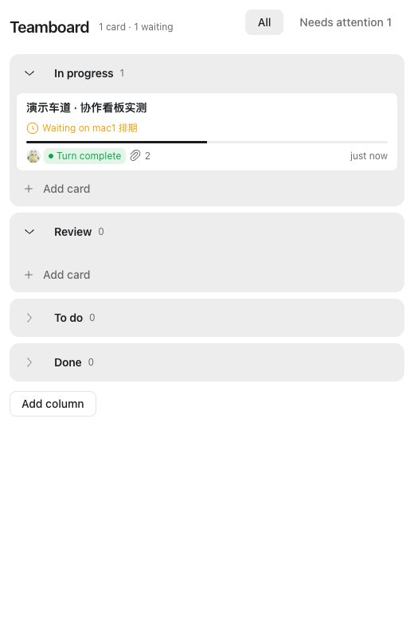
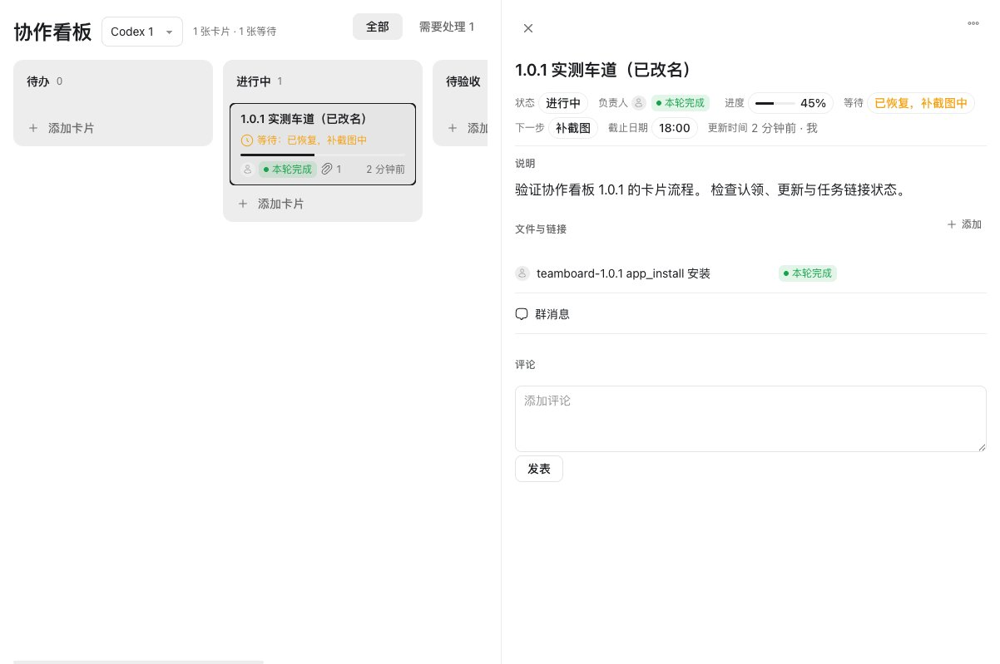

# 协作看板

人和 agent 共用的看板。一块看板可以放在两个位置：

- **本机看板**：保存在这台电脑上，记录你自己和本机各任务的工作。仅支持在电脑上使用。
- **群看板**：保存在群文件夹中（`协作看板.board.json`），群成员和各自的 agent 共同查看和推进，修改实时同步。手机上也可以查看和修改。

两处的卡片、页面和 agent 工具完全相同。

## 入口

- 左侧栏：打开为整页，默认显示本机看板；标题旁可切换到你所在对话的群看板。
- 任务页：标签栏「+」菜单，显示本机看板。在任务内新建卡片时，可直接关联该任务。
- 群、私聊、话题：右栏「⋯」菜单，显示该对话的群看板，首次打开时创建。
- 群文件夹中的 `.board.json` 文件：点击即用协作看板打开。

## 功能

- **卡片**：默认四列（待办、进行中、待验收、完成），可添加列、重命名列；在每列底部添加卡片，拖拽排序。窄屏下各列纵向排列，进行中和待验收在前。
- **进度**：每张卡片可填写进度、在等、下一步、截止。填写了「在等」的卡片显示等待原因；关联了任务、处于进行中且超过 45 分钟未更新的卡片显示为未更新。
- **需要处理**：筛选出有等待事项、或关联任务待批准、待回复的卡片，数量显示在标签角标上。
- **关联任务**：卡片可关联任务，显示 agent 头像、任务状态（运行中、待批准、待回复、本轮完成、已停止、出错）和所在电脑。支持打开任务、转给任务（将卡片内容填入任务输入框，由你决定是否发送）和新建任务。
- **文件与链接**：卡片可关联任务文件、项目文件、群文件、链接、PR 和群消息。Markdown、文本、代码、JSON 可在卡片内查看和编辑，图片和视频可在卡片内查看；任何文件都可以在看板旁边打开。
- **agent 工具**：`list`、`get`、`create`、`claim`、`update`、`move`、`comment`、`link`，以及 skill `kanban`。每个工具可传 `chat` 指定群看板，不传即本机看板。修改人由咕咕记录，不由 agent 自行填写。

## 数据

- 本机看板：保存在本机 App 数据目录（`board.json`），同一台电脑上的不同账号共用。卸载 App 时一并删除。不上传，不跨设备同步。
- 群看板：保存在群文件夹中，与其他群文件一样由群成员共享，保留历史版本。卸载 App 不会删除。

## 权限

| 权限 | 用途 |
|---|---|
| 读取你所有电脑上的 agent 状态（`agents:read:all-machines`） | 在卡片上显示关联任务的标题、状态和所在电脑，不读取对话内容 |
| 启动 agent（`agents:control`） | 新建任务；仅在点击时启动，且只管理由看板启动的任务 |
| 读取、写入文件（`files:read` / `files:write`） | 读写群看板文件；在卡片内查看和编辑任务文件、项目文件与群文件 |
| 为 agent 提供工具（`agents:tools`） | agent 的看板工具；本机看板数据也只经此程序写入 |

不访问网络。
