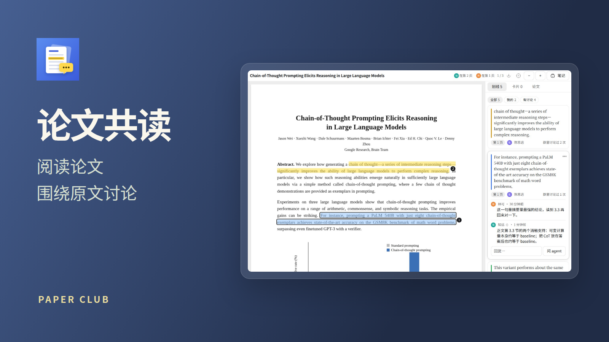
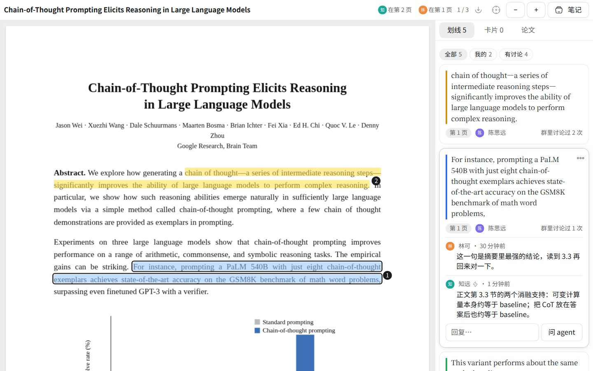
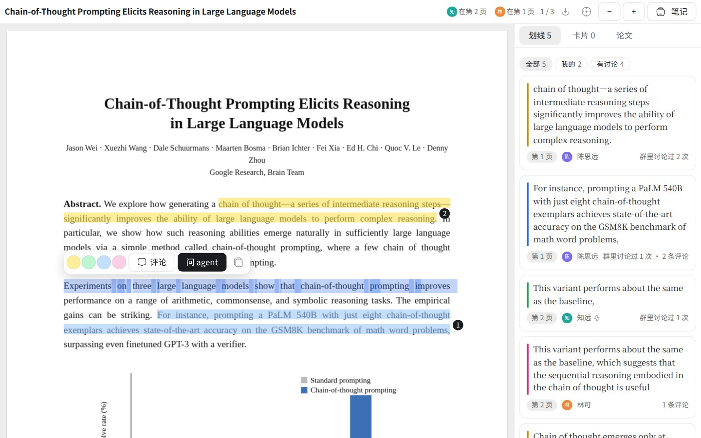
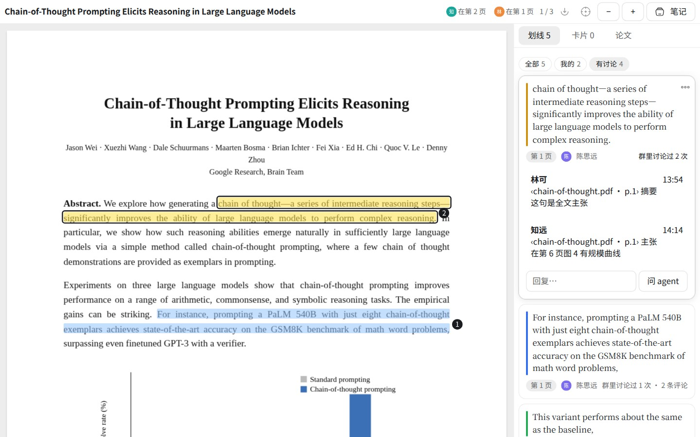

# 论文共读

一个人读，或者一个群就是一个读书会。论文的 PDF 放在本机的项目文件夹里（一个人用），或群文件夹里（大家一起读），划线、讨论和学习卡就记在它旁边的 `<论文名>.paper.json` 里。人和 agent 都用自己的身份参与，引用点一下就回到原文那一处。

- **一个人用**：打开 App 自己的页（左栏图标），在「存放位置」选一个本机项目，贴 arXiv 编号、DOI 或链接导入，或上传 PDF，导入后直接打开。选一段「问 agent」时，从本机的任务里挑一个（同项目的排在前面），这一段的原文、页码和路径放进那个任务的输入框，由你发出；也可以在这个项目里新建一个任务。agent 回答里的出处是指向这篇 PDF 的链接，在任务里点一下就回到原文。本机项目在手机上读不到，手机上请用群里的共读。

- **读**：点开群文件夹里的 PDF。选中文字可以划线，框选可以圈出图表或公式；每处划线都有自己的讨论串。顶栏显示谁在读第几页，点头像就跟着他翻页。
- **群里说过什么**：每处划线旁边显示它在群里被讨论过几次，展开就是那几条消息，点一下跳到群里。
- **问**：选一段，点「问 agent」，这一段会作为胶囊放进群的输入框，@ 群里的 agent 再发出去。agent 读全文、找证据，回答里的每一处出处都是胶囊。
- **学**：agent 出的学习卡都挂着原文出处。每个人按间隔重复复习，错题、掌握度都记下来，桌面和手机通用。
- **导入**：在群右栏的书架里贴 arXiv 编号、DOI 或链接，或者上传 PDF。

agent 能读全文、看划线和讨论、找证据、引用原文、评论、出学习卡和导入论文，读书会里的做法 App 已经教给它。

PDF 用 [PDF.js](https://github.com/mozilla/pdf.js)（Apache-2.0）渲染，打包在 `vendor/pdfjs/` 里，许可证在同一目录。
